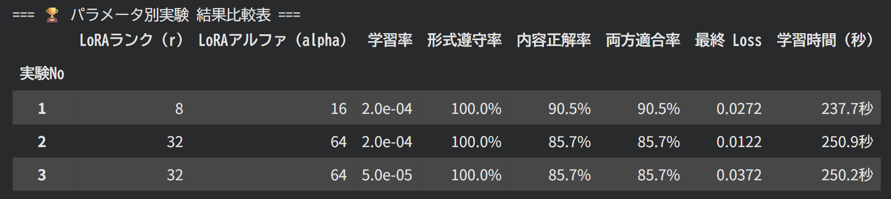

# 第2回 解答

## 演習

- 使ったモデル・設定（`result.json` の `config` から）：
- 自分で学習を実行したか（`executed_training_myself`）：はい / いいえ（実行できた範囲：　）
- 学習前：`format_rate` =　 / `content_rate` =　
- 学習後：`format_rate` =　 / `content_rate` =　
- 退行した質問：
- 学習後に残った失敗と、その型（根拠なしの質問に断定した / 根拠ありの質問に確認要求で逃げた / 形式の崩れ）：
- 知識を問う質問（セクション 6）の結果（学習前の分類 → 学習後の分類）と気づいたこと：
- 学習で変わったこと・変わらなかったこと：

## 宿題

#### 取り組んだレベル：基礎
- 変えた設定やデータ：r, lora_alpha, learning_rateの値を変更した。
それぞれ、(8, 16, 2e-4) / (32, 64, 2e-4) / (32, 64, 5e-5)の3つで比較した。

- 結果（比較表や数字

1つ目の設定では、rが小さいので表現力が複雑ではない。その分処理の速度やメモリの消費量も少なくなる。よって、3つのパラメータ設定の中で一番処理が早く終わっている。また、内容の精度なども90%を超えているので高いと言える。反対に、2,3 はrとαを大きくして表現力を高くしているのにも関わらず、内容の精度などは1つ目に劣っている。
また、表現力が複雑なので、計算により時間がかかるようになっており、およそ13秒程度処理に時間がかかっている。
2つ目と3つ目の違いは学習率で、学習率を小さくしてもほとんど結果は変わらなかった。学習率が少しおおきいほうが、loss関数の収束が十分に行えている。
もう一つで（64, 128, 5e-5）とrとαの値を各段に大きくしてみた結果、精度は90%まで上昇し、Lossも0.0144まで下がっている。しかし、272秒とより多くの時間がかかっていることが分かる。
おそらく追加で学習するデータの量が膨大ではないので、パラメータもそれに合わせてシンプルなものの方が上手くフィットする可能性が高い。

- ファインチューニングが向く場面・向かない場面についての考察
1. 出力形式や口調、手順を安定させたい場合です。例えば、常に JSON 形式で出力させたい、社内独自の文体で回答させたい、一定の手順に従って分類・要約させたい、といったケースにつよい。FTは形式・口調・手順といった振る舞いの調整に強い。プロンプトで毎回細かく指示しても、出力形式が崩れたり、指示の一部を守らなかったりする場合には、質のそろった手本を使ってFTする価値がある。うまくいけば、プロンプトを短くでき、同じ処理を大量に繰り返す場面で速度やコストを改善できる。

2. 小さなモデルを特定用途向けに使いたい場合。大きなモデルを毎回利用する代わりに、FTによって小さなモデルに特定の振る舞いを学習させれば、手元の環境や低コストの環境で運用できる可能性がある。特に、処理内容が限定され、入力と出力のパターンが比較的安定している業務に向いている。

3. データを外部に出したくない場合。オープンなモデルを自分の環境でFTし、そのまま運用できれば、機密情報を扱うシステムで選択肢になる。ただし、学習・評価・GPU運用の費用が必要になるため、導入効果との比較が必要。

逆に、最新情報や頻繁に変わる資料をモデルに覚えさせたい場合には、FTはあまり向いておらず、RAGの方が最新情報を取得し、それをコンテキストに加えて回答を生成させることができる。
データが十分にあることも重要で、足りないと実際に効果あったのかどうかの効果検証が出来なくなる。また信用性が低くなる。
FTによって元の能力を忘れたり、学習した手本に寄りすぎたりすることがあるので注意が必要。
